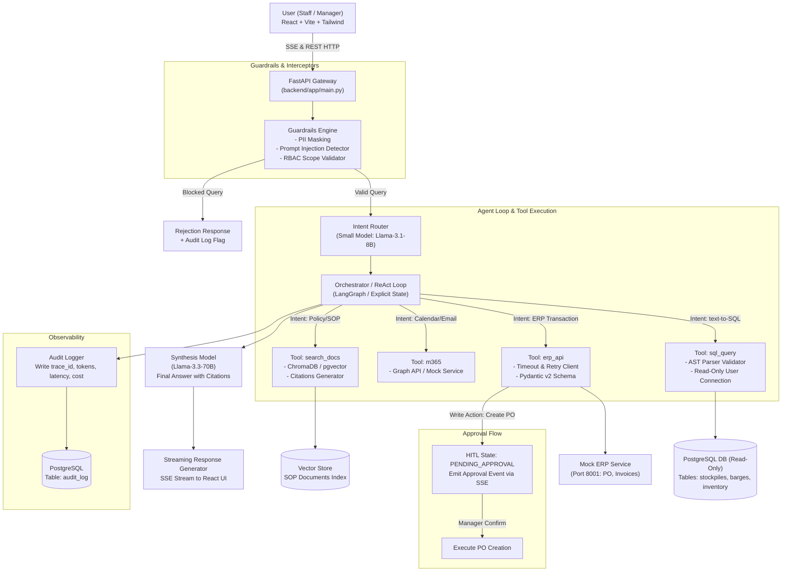
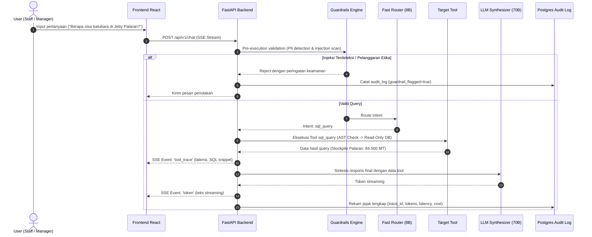

# SYSTEM ARCHITECTURE
## OpsAgent: AI Operational Assistant

Dokumen ini mendokumentasikan arsitektur sistem monorepo, aliran data antarkomponen, tata kelola keamanan *guardrails*, dan pola orkestrasi agent.

---

### 1. HIGH-LEVEL SYSTEM TOPOLOGY



---

### 2. KOMPONEN MONOREPO & PORT ALLOCATION

| Komponen | Jalur Direktori | Port Default | Deskripsi & Peran |
|---|---|---|---|
| **PostgreSQL 16 + pgvector** | `data/seed_sql/` | `5432` | Basis data operasional batubara + pencatatan audit log & vector embeddings |
| **Mock ERP Service** | `mock_erp/` | `8001` | REST API independen simulasi ERP pengadaan, stok, tagihan, dan pengapalan |
| **Backend Service** | `backend/` | `8000` | FastAPI server yang menjalankan agent loop, tools, router, guardrails, & RAG |
| **Frontend UI** | `frontend/` | `5173` | React SPA dengan streaming SSE, live tool trace, dan modal approval |

---

### 3. KEAMANAN & GUARDRAIL ARCHITECTURE



---

### 4. STRUKTUR DATA STATE AGENT (EXPLICIT REACTION STATE)
Agent menggunakan siklus state yang eksplisit:
```python
class AgentState(BaseModel):
    trace_id: str
    user_id: str
    user_role: str  # 'staff' | 'manager'
    user_query: str
    cleaned_query: str
    intent: Optional[str] = None
    tool_calls: list[ToolCall] = []
    tool_results: list[ToolResult] = []
    pending_approval: Optional[ApprovalRequest] = None
    citations: list[Citation] = []
    final_response: Optional[str] = None
    metrics: PerformanceMetrics
```
Pola state eksplisit ini memastikan setiap langkah dapat diaudit, diinterupsi saat membutuhkan *human approval*, dan dapat dimonitor secara transparan di panel *Tool Trace* frontend.
